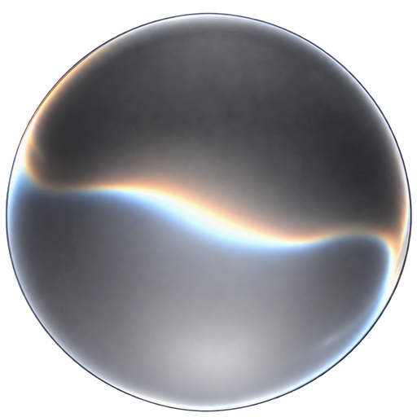

# Aera 2.2.0

**Aera** — полноценный браузер для ПК на движке Chromium (Electron), с интерфейсом в стиле Safari (macOS 27 «Golden Gate») и кнопками окна в стиле Windows. Один интерфейс работает и как настоящее окно (desktop/webview), и как встроенная страница (web-режим через iframe-прокси).



## Возможности

- **Полноценные вкладки** — webviewTag (Chromium) в desktop-режиме, iframe + прокси в web-режиме; единый UI-код (`renderer/`)
- **Новая вкладка как у флагмана** — виджеты (часы, защита, поиск), режим правки (перетаскивание, каталог виджетов), быстрые ссылки (Speed Dial), тёмная тема, glass-эстетика
- **Блокировщик рекламы и трекеров** — движок фильтров EasyList: встроенный срез `build/filters/easylist.txt` + автообновление раз в 2 суток; правила компилируются в hostSet/literals/regexes (O(1) для доменов); статистика блокировок за сессию
- **Менеджер паролей** — встроенное хранилище (`src/main/passwords.js`)
- **Расширения** — загрузка через `session.loadExtension` из `userData/extensions/<id>`; магазин расширений встроен в UI
- **Загрузки, тёмный режим, подмена UA, stealth-режим** (`darkmode.js`, `ua.js`, `stealth.js`)
- **Состояние окна, меню, IPC-слой** (`windowState.js`, `menu.js`, `ipc.js`, `security.js`, `flags.js`)

## Структура проекта

```
main.js            — точка входа Electron (только require src/main)
src/main/          — main-процесс: окна, IPC, adblock, пароли, расширения, загрузки…
src/preload/       — preload-скрипты (index.js, guest.js)
renderer/          — весь UI браузера (index.html, newtab.html, app.js, style.css, js/)
build/             — иконка + встроенный срез фильтров easylist
scripts/           — опциональная подпись сборки под Windows (PowerShell)
```

## Запуск из исходников

Требуется **Node.js 18+** (или Bun) и npm.

```bash
npm install        # или: bun install
npm start          # запуск браузера
```

## Сборка установщиков (Windows)

```bash
npm run dist
```

Результат в `dist/`:
- `Aera-Setup-2.2.0.exe` — установщик NSIS
- `Aera-Portable-2.2.0.exe` — портативная версия

> Electron ~110 МБ скачивается при `npm install`. Если скорость низкая, задайте зеркало:
> `ELECTRON_MIRROR=https://npmmirror.com/mirrors/electron/ npm install`

Опционально: самоподписанный сертификат и подпись сборки — `scripts/make-cert.ps1`, `scripts/trust-cert.ps1`, `scripts/sign-build.ps1`.

## Лицензия

MIT — см. [LICENSE](LICENSE).
